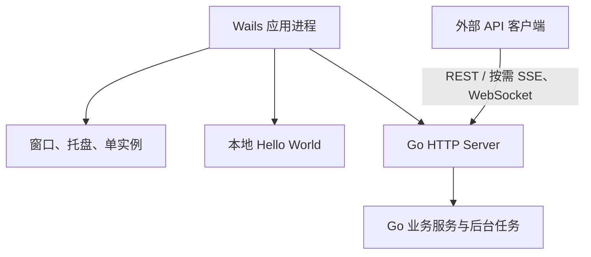

# Go API Server 与 Wails 桌面应用设计

> updated_by: HBR - GPT-6
> updated_at: 2026-10-20 23:13:17

## 已确认的架构变更

采用 Wails v3，替换 Tauri 与独立 Go sidecar 的组合。桌面窗口、托盘、HTTP 服务和业务任务运行在同一个应用进程，HTTP 服务在 goroutine 中运行。

核心收益是无需独立 sidecar 启动：不再构建和携带第二个后端可执行文件，不通过 Rust 创建子进程，不解析启动器输出，也不管理桌面与后端两个进程的生命周期。

“桌面进程退出后，Go 服务继续运行”是原设计的错误需求，现已明确撤销。关闭窗口只隐藏窗口；真正退出应用时，HTTP 服务与后台任务一起停止。不存在退出桌面后等待独立服务空闲退出的要求。

本文替代原 Tauri/sidecar 设计。旧文中的后台启动器、后台服务发现、PID 运行记录、跨进程版本兼容检查、周期探测保活及 sidecar 准备流程不再作为实施要求。历史阶段记录不代表当前架构。

## 目的与范围

以 Go 实现接口和业务能力，以 Wails v3 交付 macOS Apple Silicon 与 Windows x64 桌面应用。参考仓库为 `/Users/shuaizhexu/head-js/preset-wails`，参考其工程组织和同进程生命周期；不直接继承其全部网络策略。

参考仓库锁定 Wails v3.0.0-beta.32；截至 2026-10-20，官方最新发布为 beta.33，仍是预发布版本。实施时明确锁定框架与项目内 CLI 版本，不依赖全局 CLI。

不纳入骨架的能力包括自动更新、深链、数据库兼容性预检及尚无实际需求的通用事件总线。框架提供能力不等于项目必须启用。

## 已确认需求

| 项目 | 要求 |
| --- | --- |
| 主体功能 | Go 业务服务 |
| 桌面载体 | Wails v3，与业务服务同进程 |
| 当前网络接口 | RESTful HTTP API |
| 后续协议 | 保留增加 SSE、WebSocket 的能力，按实际需求实现 |
| RPC | 当前原始需求未明确指定 RPC 协议；继续调查，尚未选定 JSON-RPC、gRPC 等方案 |
| 页面 | 本地 Hello World；不导航到业务 HTTP 服务地址 |
| 业务 HTTP | 不提供 HTML、静态资源、文档页面或 SPA 回退 |
| 托盘 | 显示窗口、打开日志目录、退出 |
| 关闭窗口 | 隐藏窗口，服务和任务继续运行 |
| 退出应用 | 关闭服务、停止任务、释放资源，退出整个进程 |
| 重复启动 | 激活已有应用，不产生第二个业务服务 |
| 系统服务 | 不注册系统服务，不要求开机启动 |
| 交付 | macOS `.app`、Windows `.exe`，用户无须安装开发工具链；处理必要的 WebView 运行时依赖 |

## 总体结构

窗口、托盘和 HTTP 服务由同一个 Go 应用入口组装。业务服务接受 context.Context，不依赖 Wails、WebView 或 HTTP 请求对象。独立 API 调试入口可以复用业务代码，不作为桌面的子进程启动。

Wails 负责本地页面资源，业务 HTTP 只提供 API。“业务 HTTP 不提供页面”不禁止 Wails 使用 Go embed 携带桌面页面。

## 接口形态与协议边界

### 原始需求核查

原设计明确提出当前 RESTful HTTP，以及后续可以增加 SSE、WebSocket；未提到 RPC、JSON-RPC 或 gRPC。不得将“后续可以增加”改写为所有协议必须立即实现。RPC 作为本轮新增调查项记录，具体用途和协议尚未确认。

### 接口形态调查结论

| 形态 | 适用用途 | 实现边界与当前状态 |
| --- | --- | --- |
| REST HTTP | 查询、配置、普通请求响应 | 已确认的外部业务接口，采用 net/http 与 Huma |
| SSE | 任务进度、日志、模型增量输出等服务端单向推送 | 按需增加标准 HTTP 流式端点 |
| WebSocket | 客户端与服务端持续双向通信 | 按需增加标准 WebSocket 端点，可与 REST 共用业务监听端口 |
| RPC | 按方法调用并返回结果 | 尚未指定协议；JSON-RPC 与 gRPC 属于候选调查方向，不代表已经选型 |
| Wails Go 方法绑定 | 桌面 JavaScript 调用 Go 方法 | 桌面内部调用，不自动提供对外 JSON-RPC 或 gRPC 契约 |
| Wails Events | 桌面页面与 Go 之间的事件通知 | 框架内部事件，不等同于标准 SSE |
| Wails GoStream | 桌面页面与 Go 之间的双向流 | beta.32 桌面模式通过长轮询与 POST 实现，不等同于标准 WebSocket |

外部客户端使用的协议与桌面内部通信分别设计。取消 sidecar 不限制外部 REST、SSE、WebSocket 或后续 RPC 的实现，也不意味着需要把业务 HTTP 接口全部改为 Wails 绑定。

RPC 后续调查需要明确调用方、是否要求浏览器直接访问、是否要求跨语言契约、单次调用或流式调用，以及认证与错误模型，再决定具体协议。当前不新增 RPC 依赖或端点。

### 外部业务接口

采用 net/http 与 Huma 定义 REST 输入输出、参数校验及 OpenAPI。Handler 处理协议，业务服务承载规则。

| 接口 | 用途 |
| --- | --- |
| GET /api/ping | 健康状态 |
| GET /api/v1/version | 服务版本和 API 版本 |
| /api/openapi 下的机器可读接口 | OpenAPI 契约，具体格式路径按 Huma 配置 |

关闭 Huma 文档 HTML 与独立 schema 路由。未注册页面路径返回 404。

SSE 用于服务端向客户端持续推送文本事件，例如任务进度、日志或模型增量输出。WebSocket 用于需要双向持续消息的场景。二者可以与 REST 共用同一个 HTTP Server 和监听端口，不需要新增进程。

RPC 表示方法调用模型，并非与 SSE、WebSocket 同一层的传输选择。若需要外部 RPC，需另外明确客户端、契约、调用与流式语义；Wails Go 方法绑定不能直接视为对外的 JSON-RPC 或 gRPC 服务。

### 桌面页面与 Go 的通信

Wails 提供生成的 Go 方法绑定、事件和流能力。现有 preset-wails 的业务页面实际使用 fetch 请求独立 HTTP 监听端口，并未使用业务方法绑定。

Wails beta.32 的 GoStream 在桌面模式使用资源通道上的长轮询和 POST，提供双向流式编程接口；它不是标准 SSE 或标准 WebSocket 端点。框架也允许自定义 IPC Transport，并有 WebSocket 示例。这些属于桌面内部通信，不能替代外部客户端要求的标准协议。

当前 Hello World 没有业务交互需求，不强制引入绑定或自定义 Transport。后续桌面页面使用 HTTP 还是绑定，按新需求确定，不在本轮调查中擅自选定。

### 流式连接与退出

流式接口单独处理超时、取消、心跳和慢客户端，不套用会截断流的普通 REST 超时。退出时取消 SSE，显式关闭并等待 WebSocket 连接；http.Server.Shutdown 不会自动管理已接管的 WebSocket 连接。Wails 内部事件与流的清理不能替代业务 HTTP 连接清理。

## 应用生命周期

1. 确定配置和独立用户数据目录，建立日志。
2. 建立应用单实例机制，重复启动恢复已有窗口。
3. 同步创建 HTTP listener，确认端口绑定结果后启动 Serve goroutine；不把创建 goroutine 当成服务就绪。
4. 创建托盘与窗口，托盘可用后启用关闭隐藏。
5. 运行期间直接接收服务状态和错误，不解析子进程日志，不依赖 WebView 定时器。
6. 应用退出时取消后台工作，以独立超时 context 执行 HTTP Shutdown，必要时强制关闭，等待任务结束并释放资源。

具体入口顺序需保证第二实例不会在单实例检查前抢占端口，服务启动失败不会留下正常工作的空壳窗口。Wails OnShutdown 或 Service 生命周期可承担资源清理；启动钩子不得阻塞在长期运行的 Serve 循环。

服务异常需保留可定位错误并展示状态；是否退出整个应用按后续错误策略确定，不默认承诺自动重启。

不再为“桌面退出后独立后端存活”设计后台启动锁、PID 文件、服务复用、空闲退出及 serve status/stop 管理协议。如以后要求独立无窗口运行，另行明确 CLI 需求，不恢复 sidecar 启动链路。

## 网络与基础配置

保留原始默认回环监听、允许配置地址和端口、支持动态端口的能力。实际地址从 listener 直接获得。配置优先级、Host 校验、认证及受信任来源按业务需要实现，不将 token 写入日志。

preset-wails 固定监听 0.0.0.0:20080、CORS *、端口冲突退出，是参考仓库自己的选择，不自动成为本项目需求。没有业务页面跨域访问需求时，不为 Hello World 开放 CORS。WebSocket 按实际客户端补充认证及 Origin 检查。

## 桌面与交付

保留原生托盘、窗口显示与隐藏、恢复聚焦、macOS 重新打开及重复启动激活。托盘初始化失败要有可见反馈，避免隐藏后失去恢复入口。

生产构建将本地页面携带到桌面程序，得到目标平台产物，不附带独立 hub 二进制。统一产品名和版本输入，开发环境使用独立数据目录。完成 macOS 与 Windows 的实际验收，不将源码支持等同于已验证。

参考仓库当前主要完成开发链路；前端生产构建、资源嵌入及完整发布流程仍需补齐。签名、公证和分发按交付要求设计。

## 实施与验收

1. 建立 Wails 同进程入口，复用 Go HTTP 与业务代码，移除 Tauri/sidecar 接入设计。
2. 保留健康、版本、OpenAPI 与配置能力，核对原接口兼容性。
3. 接入托盘、关闭隐藏、单实例与统一退出清理。
4. 完成生产资源与目标平台构建。
5. 按实际业务需求决定 RPC、SSE、WebSocket 的具体端点及契约。

验收包括：API 可访问且不返回页面；关闭窗口后 API 正常；重复启动恢复已有实例；应用退出后端口与后台任务释放；端口冲突、初始化失败和运行错误可定位；托盘可以恢复窗口；安装产物不依赖开发工具链且无需 sidecar。引入流式接口后补充取消、慢客户端、断线及退出清理验证。

## 调查依据

- 参考仓库：/Users/shuaizhexu/head-js/preset-wails，重点为 main.go、api.go、server.go、tray.go 和构建配置。
- [Wails 服务生命周期](https://github.com/wailsapp/wails/blob/v3.0.0-beta.32/v3/pkg/application/services.go)。
- [Wails IPC Transport](https://github.com/wailsapp/wails/blob/v3.0.0-beta.32/v3/pkg/application/transport.go)。
- [Wails GoStream 实现](https://github.com/wailsapp/wails/blob/v3.0.0-beta.32/v3/pkg/application/stream.go)。
- [Wails 流示例](https://github.com/wailsapp/wails/tree/v3.0.0-beta.32/v3/examples/streams)。
- [Wails WebSocket Transport 示例](https://github.com/wailsapp/wails/tree/v3.0.0-beta.32/v3/examples/websocket-transport)。
- [Wails beta.33 发布记录](https://github.com/wailsapp/wails/releases/tag/v3.0.0-beta.33)。
