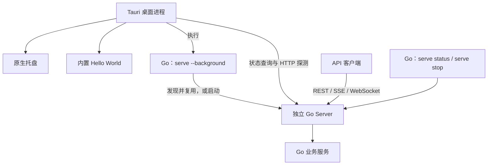

# Go API Server 与 Tauri 桌面载体设计

## 目的与范围

新建一个独立项目，以 Go 提供接口和业务能力，以 Tauri 交付桌面应用。
AgentsView 仅作为架构与开发模式的参考资料。新项目独立编写代码，不复制、
抽取或迁移参考项目中的实现。

本文是已确认需求对应的设计，尚未在新项目中实施。本文在参考仓库中的保存
不代表后续功能将在该仓库开发。

设计以参考项目当前已经使用的机制为基线。需求覆盖范围内优先沿用其职责
划分和运行方式；删去无关业务能力，避免另行设计进程通信和监督框架。

## 已确认需求

| 项目 | 要求 |
| --- | --- |
| 主体功能 | 由 Go Server 实现 |
| 当前网络接口 | RESTful HTTP API |
| 后续协议 | 可以增加 SSE、WebSocket |
| 交付方式 | Tauri 桌面应用，随包携带 Go sidecar |
| 托盘 | 由 Tauri 实现 |
| 系统服务 | 无须注册 systemd、launchd 或 Windows Service |
| Rust 职责 | 桌面生命周期、托盘、窗口、调用 Go 命令、探测后端 |
| 页面 | Tauri 内置一个 Hello World 静态页面 |
| Go 页面能力 | 不提供 HTML、静态资源、文档页面或 SPA 路由 |
| 开发位置 | 另建项目，独立实现 |

## 参考依据与裁剪

以下链接指向参考项目源码，供理解设计使用，不是新项目的代码依赖。

| 机制 | 参考位置 | 新项目采用方式 |
| --- | --- | --- |
| sidecar 声明与本地 HTML | [Tauri 配置](../desktop/src-tauri/tauri.conf.json) | 保留 `externalBin` 与 `frontendDist` 的组织方式 |
| Go 构建与目标平台命名 | [准备脚本](../desktop/scripts/prepare-sidecar.sh) | 独立实现目标平台映射及 sidecar 准备流程 |
| Rust 启动与状态处理 | [桌面实现](../desktop/src-tauri/src/lib.rs) 中的 `spawn_sidecar_with_args`、`sidecar_args`、`forward_sidecar_logs` | 沿用命令调用、输出处理和状态查询流程 |
| Go 后台启动 | [后台启动实现](../cmd/agentsview/serve_background.go) | 沿用启动器发现已有服务或创建后台进程的模型 |
| 运行记录与服务发现 | [运行记录实现](../cmd/agentsview/daemon_runtime.go) | 保留运行记录、进程身份和兼容性检查的职责 |
| 查询和停止服务 | [生命周期实现](../cmd/agentsview/serve_lifecycle.go) | 由 Go 命令统一管理，停止前确认进程身份 |
| 托盘与关闭隐藏 | [桌面实现](../desktop/src-tauri/src/lib.rs) 中的 `setup_status_item`、`setup_window_lifecycle` | 保留原生托盘、恢复窗口和关闭隐藏 |
| HTTP 与 Huma | [服务实现](../internal/server/server.go) | 使用 `net/http` 与 Huma，关闭文档 HTML |
| 空闲退出 | [空闲跟踪](../internal/server/idle.go) 与 [Go 启动入口](../cmd/agentsview/main.go) | 保留可配置空闲退出及请求活跃计数 |

参考项目使用了 `go.kenn.io/kit/daemon` 等公共依赖。新项目实施时可以评估
这些现成库，但不得将参考仓库中的应用代码复制到新项目。本文确定的是
行为与职责，不承诺已有库能直接满足全部接口。

不纳入骨架的内容：会话解析、归档和镜像数据库、同步监听、价格快照、
业务前端、页面跳转和重载、深链、自动更新、数据库兼容性预检。

## 总体结构



Tauri 启动打包的 Go sidecar 命令。该命令负责发现兼容的已有服务，或启动
独立的 Go 后台进程；启动命令完成后可以退出。长期运行的 Go Server 不依赖
启动命令持续存活。

后台进程运行在当前用户会话中，不安装系统服务，也不包含开机启动配置。
Tauri 是桌面入口，Go 命令是后端生命周期的统一管理入口。

## Go Server

### 命令入口

使用 Cobra 组织命令。以下以 `server` 代指新项目的可执行文件名。

```text
server serve
server serve --background --host 127.0.0.1 --port 0
server serve status
server serve stop
```

- `serve` 在前台运行接口服务，供独立使用、调试和自动化验证。
- `serve --background` 发现兼容服务或启动后台服务，报告结果后返回。
- `serve status` 查询启动中、运行中、不可用或版本不兼容等状态。
- `serve stop` 确认目标进程身份后停止服务，并处理运行记录。

参考项目的 `serve status` 在没有服务时也可以返回零退出码。新项目的桌面
调用方不能只凭退出码判断服务就绪，必须解释状态输出并进行 HTTP 探测。
新项目应为桌面依赖的输出格式和退出码约定增加契约验证。

### HTTP 与业务边界

采用 `net/http` 提供 HTTP 服务，以 Huma 定义 REST 输入输出、参数校验和
OpenAPI。Handler 处理协议细节，业务服务承载业务规则。

骨架保留以下基础接口：

| 接口 | 用途 |
| --- | --- |
| `GET /api/ping` | 报告进程和服务健康状态 |
| `GET /api/v1/version` | 报告服务版本和 API 兼容版本，支持桌面探测 |
| `/api/openapi` 下的机器可读 OpenAPI | 提供接口契约，具体格式路径以 Huma 配置为准 |

Huma 关闭文档页面与独立 schema 路由。Go 不使用页面 `embed`，不设置静态
文件服务器、SPA fallback 或浏览器自动打开逻辑。未注册的页面路径返回
404。Hello World 不属于 Go 服务。

业务服务接受 `context.Context`，不依赖 Tauri、WebView 或 HTTP 请求对象。
初期不创建没有实际业务需要的存储接口、事件总线或通用协议框架。

### 后续 SSE 与 WebSocket

两者可以挂载到同一个 HTTP Server 和监听端口。沿用参考项目按需注册
原生 HTTP handler 的方式，与 Huma REST 接口共存。

实现时单独处理流式请求的超时、取消和慢客户端，不套用会截断流的普通
REST 超时包装。退出时取消 SSE，并显式关闭和等待 WebSocket 连接；不能
假设 `http.Server.Shutdown` 会自动管理已经接管的 WebSocket 连接。

骨架阶段不提前实现这两个协议。

## 服务发现、启动与停止

### 启动流程

1. Go 启动命令获取启动锁，串行处理启动和已有服务检查。
2. 读取新项目自己的运行记录，并确认进程身份、接口响应及兼容性。
3. 已有兼容服务时报告其地址；没有服务时启动独立后台进程。
4. 后台进程初始化配置和业务资源，监听接口并发布运行状态。
5. 启动命令报告启动结果和日志位置，随后退出。
6. Tauri 解释输出；未获得就绪地址时，通过状态命令继续查询。
7. Tauri 对所选地址进行 HTTP 就绪探测，成功后记录后端可用。

启动器成功退出、服务已经就绪、服务健康是不同状态。必须保留启动超时、
初始化失败和查询失败的可见信息，避免把启动器退出当成服务故障。

同一个用户数据目录对应一个可复用的服务实例。Tauri 单实例插件解决桌面
重复启动，Go 启动锁解决命令行和桌面并发启动；两者分别保留。

### 运行记录与兼容性

运行记录保存服务地址、PID、版本及用于确认进程身份的证据。启动命令和
状态命令结合运行记录与实际探测判断服务状态，不能只相信文件中的 PID。

停止前重新确认身份，避免 PID 被其他进程复用时误杀。失效记录按实际进程
状态处理。不兼容的已有服务必须明确报告，不能静默当作可用服务连接。

数据目录、配置、运行记录和日志属于新项目，不能使用参考项目的目录或
标识。独立 API 模式和桌面模式使用同一套配置规则。

### 停止流程与平台差异

由 `serve stop` 统一确认并停止目标服务，Rust 不另建 stdin 控制协议。
正常关闭时 Go 停止接收新工作，结束服务和后台任务，再释放资源及运行记录。

参考项目在 Unix 上发送 SIGTERM 并等待退出，超时后执行强制停止；Windows
后台停止使用强制终止。因此本设计不承诺 Windows 具有相同的优雅退出
语义。若后续业务要求 Windows 必须完成事务或连接排空，需要将其列为
明确的新需求，再设计对应机制。

## Tauri 桌面载体

### Rust 职责

- 使用 shell 插件调用随包交付的 Go 二进制。
- 处理启动输出、查询状态并进行 HTTP 探测。
- 使用 single-instance 插件恢复已有窗口。
- 创建原生托盘，管理窗口显示、隐藏及应用退出。
- 保留启动失败信息和桌面日志。

Rust 不实现 HTTP API，不转发业务请求，不渲染业务页面。Hello World 没有
业务交互需求，因此初版不需要自定义 Tauri command。

持续消费启动命令的 stdout、stderr 和结束事件。长期 Go 服务日志写入自己的
日志文件；不能在启动器退出后假设 Rust 仍持有后台服务的日志管道。

### HTML 与权限

`frontendDist` 指向 `desktop/ui`。主窗口始终加载其中的 `index.html`，显示
Hello World；不导航到 Go 服务地址。

使用原生 HTML 即可，不引入业务前端框架。可以通过参考项目已有的本地
页面状态更新方式报告启动错误，正常页面保持简单。

Tauri capabilities 和 CSP 按本地页面实际需要配置。不继承参考项目为远程
业务页面开放的权限、远程来源或宽泛网络规则。不把启动 sidecar 的权限
授予网页 JavaScript；由 Rust 执行启动命令。

### 托盘与窗口

初版托盘提供“显示窗口”“打开日志目录”“退出”。打开日志目录采用原生
opener 能力。自动更新、深链及 Dock 显示偏好不进入基础骨架。

沿用参考项目的顺序：托盘创建成功后才启用关闭隐藏，避免托盘创建失败时
窗口被隐藏而无法恢复。托盘是需求项，初始化失败应明确提示。

| 操作 | 结果 |
| --- | --- |
| 点击关闭窗口 | 隐藏窗口，桌面进程和后台 Go 保持运行 |
| 选择显示窗口 | 显示、恢复并聚焦原有窗口 |
| 再次启动应用 | 激活已有桌面实例 |
| 退出桌面应用 | 退出 Tauri，不在此路径强制停止独立 Go 服务 |
| 执行 `serve stop` | 停止 Go 服务；桌面通过探测更新其可用状态 |

macOS 保留原生重新打开窗口的处理。参考项目当前只在 macOS、Windows
启用托盘；Linux 需根据最终目标桌面环境单独实现和验收。

### 后端探测与空闲退出

保留运行在 Rust 侧的周期性 HTTP 探测。窗口隐藏后 WebView 可能暂停，后端
状态检测不能依赖 HTML 定时器。

删除参考项目探测成功后的页面跳转、重载和深链处理。后端恢复只更新状态，
不刷新 Hello World。周期性探测不等于自动重启，本骨架不承诺崩溃后自动
拉起；重新打开桌面时再通过标准启动命令发现或启动服务。

沿用可配置的后台空闲退出机制，以参考项目的五分钟作为初始默认值。HTTP
请求与正在执行的后台工作参与活跃计数，持续连接也需在实现时正确计数。
Rust 探测间隔参考现有三十秒设置，小于默认空闲超时。

桌面运行且探测正常时，服务保持活跃。桌面退出后，服务在没有其他请求或
工作时按空闲策略退出；有其他客户端时继续服务。空闲超时设为零可关闭
自动退出。配置变更需要避免空闲超时短于桌面探测间隔造成意外退出。

## 网络与基础配置

桌面启动参数参考当前项目：`--host 127.0.0.1 --port 0`。由 Go 服务启动流程
报告实际地址，Tauri 通过输出和状态查询发现它，不写死端口。

Go 独立运行允许显式配置地址和端口。外部客户端可以使用固定端口配置，
或通过状态命令发现动态端口。

沿用参考项目配置优先级、Host 校验和按需认证的设计思想。默认监听回环
地址；远程监听、受信任来源与认证需要显式配置。没有业务网页时，不为
Hello World 开放跨域访问，也不把 token 放入启动日志。未来 WebSocket
接入时补充对应的认证和 Origin 检查。

## 目录建议

目录表达职责，不要求提前创建空模块。`internal/daemon` 是新项目的组织
建议，不表示参考项目已有同名包可直接迁移。

```text
project/
├── go.mod
├── cmd/server/                # Cobra 命令与依赖组装
├── internal/
│   ├── server/                # net/http、Huma、健康和版本接口
│   ├── service/               # 按需增加的业务服务
│   ├── daemon/                # 锁、运行记录、启动、查询、停止
│   └── config/                # 配置和用户数据目录
├── desktop/
│   ├── package.json
│   ├── ui/index.html          # 本地 Hello World
│   ├── scripts/               # sidecar 准备和 Tauri 构建入口
│   └── src-tauri/
│       ├── Cargo.toml
│       ├── tauri.conf.json
│       ├── build.rs
│       ├── capabilities/
│       ├── icons/
│       ├── binaries/          # 生成的 Go 二进制
│       └── src/
│           ├── main.rs
│           ├── lib.rs        # 桌面组装
│           ├── sidecar.rs    # 命令调用和后端状态
│           └── tray.rs       # 托盘与窗口
├── scripts/
└── Makefile
```

## 开发与打包

沿用参考项目的“先准备 sidecar，再运行 Tauri”开发方式。

| 模式 | 流程 |
| --- | --- |
| Go 开发 | 独立运行前台服务，直接请求 API |
| 桌面联调 | 构建本机 Go sidecar，再执行 Tauri dev |
| 发布构建 | 构建目标平台 Go sidecar，再执行 Tauri build |

构建脚本确定统一的目标平台，将 Rust target triple 映射到 Go 的 `GOOS`
和 `GOARCH`，并生成 Tauri 要求的文件名。例如：

```text
server-aarch64-apple-darwin
server-x86_64-pc-windows-msvc.exe
```

`externalBin` 声明逻辑路径 `binaries/server`。生成的二进制不作为源码提交。
版本从统一构建输入注入 Go 和 Tauri，保证同一安装包中的版本信息一致。

最终用户无须安装 Go、Rust 或 Node.js 工具链。开发联调使用独立数据目录，
避免复用已安装版本的服务、运行记录或配置。

不继承参考项目的 CGO、FTS5、SQLite、价格快照和业务前端构建要求。是否
需要 CGO 由新项目实际依赖决定。跨平台发布优先在目标平台构建和验收，
不能仅凭设置 `GOOS` 就认定整个 Tauri 应用可以跨平台打包。

## 实施顺序与验收

1. 实现 Go 前台服务、基础 API、版本和配置入口，确认独立运行。
2. 实现后台启动、启动锁、运行记录、状态与停止命令，验证兼容服务复用。
3. 创建 Tauri 与本地 Hello World，接入 sidecar 构建和标准启动流程。
4. 加入托盘、关闭隐藏、单实例、就绪与周期性探测、日志及失败提示。
5. 验证桌面退出、空闲退出及手动停止，完成目标平台打包验收。

重点检查真实进程和交付行为：

- Go 前台启动与桌面启动均可访问接口，所有页面路径无 HTML 响应。
- OpenAPI 机器可读，文档 HTML 关闭。
- 重复和并发启动不会生成重复服务，不兼容服务得到明确报告。
- 启动器正常退出后，Tauri 仍可识别后台服务。
- 缺少 sidecar、端口冲突、启动失败和超时有可见信息与日志。
- 陈旧记录与 PID 复用不会导致误连或误杀其他进程。
- 隐藏窗口后托盘和原生探测继续运行，能够恢复原有窗口。
- 桌面退出保留 Go；无其他活动时按配置空闲退出。
- 持续请求或活动连接不会被错误判定为空闲。
- `serve stop` 停止正确实例，并遵循实际平台的退出语义。
- Windows 后台启动不弹控制台窗口。
- 安装包在没有开发工具链的环境中能找到并启动随包 Go 二进制。

具体目标操作系统和架构在新项目初始化时确定。其余基础设计按本文实施，
新增业务能力再按实际需求扩展。
